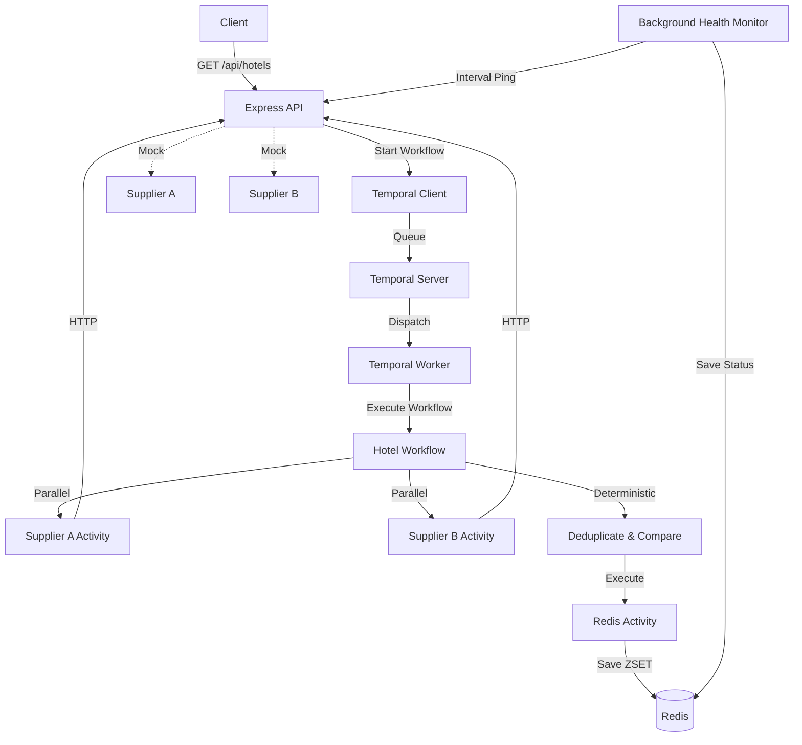

# Hotel Offer Orchestrator

A robust backend service for aggregating hotel offers from multiple mock suppliers using Temporal.io for orchestration and Redis for caching and filtering.

## Project Overview

The Hotel Offer Orchestrator fetches hotel offers from two unreliable mock suppliers (Supplier A and Supplier B), deduplicates them by hotel name, selects the cheapest offer for overlapping hotels, and caches the results in Redis. It utilizes Redis sorted sets to efficiently filter hotels by price range.

The project demonstrates production-ready patterns for handling unreliable external APIs using Temporal's orchestration, retry policies, and background health monitoring.

## Architecture



## Technologies

*   **Node.js**: Runtime environment
*   **TypeScript**: Strongly-typed language
*   **Express**: Web framework for API and mock suppliers
*   **Temporal**: Workflow orchestration for reliable execution
*   **Redis**: Caching final offers and health status, and price filtering
*   **PostgreSQL**: Database for Temporal
*   **Docker**: Containerization
*   **Jest**: Unit testing

## Local Setup

1.  **Clone the repository.**
2.  **Install dependencies:**
    ```bash
    npm install
    ```
3.  **Environment Variables:**
    Copy `.env.example` to `.env` and adjust if necessary.
    ```bash
    cp .env.example .env
    ```

## Running Without Docker

You need to have Redis and Temporal Server running locally.

1.  **Start Redis:** Ensure Redis is running on `localhost:6379`.
2.  **Start Temporal:** Ensure Temporal server is running on `localhost:7233`.
3.  **Start the Express API:**
    ```bash
    npm run dev
    ```
4.  **Start the Temporal Worker (in a separate terminal):**
    ```bash
    npm run dev:worker
    ```

## Running With Docker Compose

The easiest way to run the entire stack is using Docker Compose.

```bash
docker compose up --build
```

This will start:
*   `postgres`: PostgreSQL database for Temporal on port `5432`
*   `redis`: Redis server on port `6379`
*   `temporal`: Temporal server on port `7233`
*   `temporal-ui`: Temporal Web UI on `http://localhost:8080`
*   `api`: Express API on `http://localhost:3000`
*   `worker`: Temporal Worker process

## API Documentation

### 1. Get Hotels

Fetches deduplicated hotel offers.

**Endpoint:** `GET /api/hotels`

**Query Parameters:**
*   `city` (required): City to search (e.g., `delhi`)
*   `minPrice` (optional): Minimum price filter
*   `maxPrice` (optional): Maximum price filter

**Example Request:**
```
GET /api/hotels?city=delhi&minPrice=5000&maxPrice=7000
```

### 2. Health Check

Returns the latest health status of the suppliers. Read from Redis cache, so it is fast and doesn't block.

**Endpoint:** `GET /health`

### 3. Supplier APIs (Mock)

Direct endpoints for the mock suppliers. These randomly delay and fail based on configuration.

**Endpoints:**
*   `GET /supplierA/hotels?city=delhi`
*   `GET /supplierB/hotels?city=delhi`

## Temporal Explanation

*   **Workflow**: `hotelOfferWorkflow` orchestrates the logic: calls suppliers in parallel, deduplicates deterministically, and interacts with Redis.
*   **Activity**: Code that interacts with the outside world (HTTP calls to suppliers, Redis commands).
*   **Worker**: A separate process (`worker.ts`) that listens to the `hotel-task-queue` and executes Workflows and Activities.
*   **Client**: The Express API (`getTemporalClient()`) uses the client to start the Workflow and wait for the result.
*   **Task Queue**: The queue (`hotel-task-queue`) where the Temporal Server places tasks for the Worker to pick up.
*   **Retry Policy**: Activities configured with retry policies (e.g., up to 3 attempts, with backoff) to handle transient supplier failures seamlessly.

## Redis Explanation

*   **Hotel Sorted Sets (ZSET)**: Deduplicated hotels are saved in Redis using the key format `hotels:{city}`.
*   **Price Filtering**: The price is used as the ZSET `score`. When `minPrice` or `maxPrice` is provided, the filtering is done efficiently by Redis using `ZRANGEBYSCORE`.
*   **Health Status Storage**: The background health monitor saves supplier status to the key `health:suppliers` as a JSON string, which the `/health` endpoint reads.

## Failure Simulation

The mock supplier APIs (`/supplierA/hotels` and `/supplierB/hotels`) intentionally simulate unreliability:
*   **Random Delay**: Configurable delay (default 200ms - 3000ms) is introduced before responding.
*   **Random Failure**: Configurable failure rate (default 20%) where the API returns HTTP 503.
*   **Temporal Retries**: If a supplier activity fails (e.g., gets a 503), Temporal automatically retries it according to the configured Activity retry policy. This hides transient failures from the end user.

For deterministic testing (e.g., with Postman), you can set `SUPPLIER_FAILURE_RATE=0` in your `.env` file.

## Health Monitoring

A background service (`HealthMonitorService`) periodically pings both supplier endpoints independently. It does not block one if the other fails. The results are stored in Redis. The `/health` endpoint simply reads this cached status from Redis, ensuring high availability and fast response times even if suppliers are degraded.

## Postman

A Postman collection is included in the `postman/` directory.

1.  Open Postman.
2.  Click **Import**.
3.  Select the `postman/hotel-offer-orchestrator.postman_collection.json` file.
4.  The collection includes requests for testing the main API, filtering, health checks, and individual suppliers.
